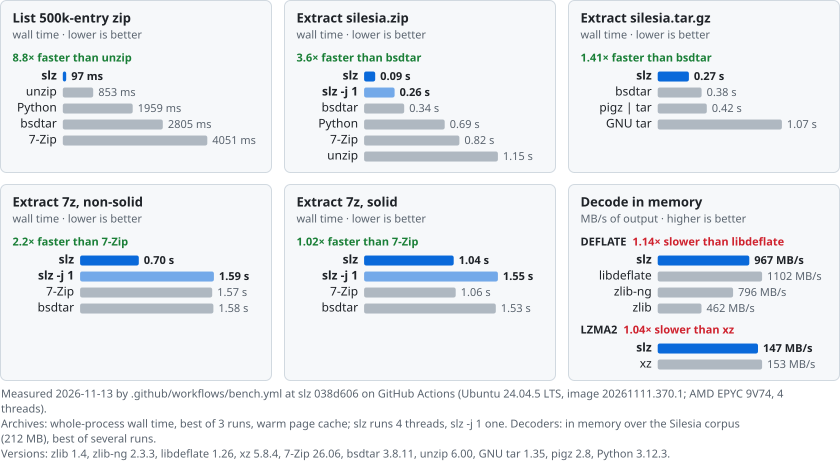
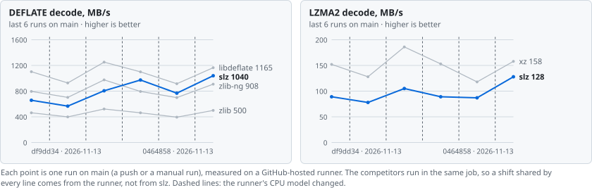

# slz

[](https://github.com/seregonwar/slibz/actions/workflows/ci.yml)
[](https://github.com/seregonwar/slibz/actions/workflows/bench.yml)
[](#continuous-benchmarks)
[](#continuous-benchmarks)
[](#continuous-benchmarks)
[](LICENSE)
[](https://github.com/seregonwar/slibz/stargazers)

**Fast, hardened archive extraction in C99 + assembly: zip/zip64, 7z, tar, gzip, tar.gz.**
Lists huge archives in milliseconds, extracts at SSD speed, and can extract *in place*, freeing the
archive's space as it goes, without needing extra free disk.

<a href="#continuous-benchmarks"><picture>
  <source media="(prefers-color-scheme: dark)" srcset="https://raw.githubusercontent.com/seregonwar/slibz/bench-data/svg/hero-dark.svg">
  
</picture></a>

<sub>Redrawn by CI after every push to `main`, on a GitHub-hosted runner: [how it is measured](#continuous-benchmarks) · [detailed tables](#performance)</sub>

Created by **Seregon**. Copyright (c) 2026 Seregon. Released under the [MIT License](LICENSE).

Windows, macOS, Linux, FreeBSD, WebAssembly (WASI). No dependencies.

| | |
|---|---|
| **Listing** | 500 000 zip entries in 75 ms (one read of the central directory, parsed in place) |
| **Extraction** | parallel, in on-disk order; fastest measured on zip, tar.gz and non-solid 7z vs the latest 7-Zip and libarchive (see [Performance](#performance)) |
| **In-place extraction** | a 30 GB archive extracts into ~30 GB of output: peak = max(archive, output) + one checkpoint |
| **Crash safety** | journaled; survives kill -9 and power loss at any point, resumes inside an entry |
| **Hardening** | bounded parsers, no link following, overlap/bomb checks; differential fuzzing vs zlib and xz |
| **Size** | ~4 400 lines of library C and ~130 lines of assembly |

## Contents

1. [Quick start](#quick-start)
2. [Formats](#formats)
3. [In-place (destructive) extraction](#in-place-destructive-extraction)
4. [Security](#security)
5. [Verification](#verification)
6. [Continuous benchmarks](#continuous-benchmarks)
7. [Performance](#performance)
8. [Platforms](#platforms)
9. [Integration](#integration)
10. [Project layout](#project-layout)
11. [Limits and roadmap](#limits-and-roadmap)
12. [Star history](#star-history)
13. [License](#license)

## Quick start

```bash
cmake -S . -B build && cmake --build build --config Release
```

```bash
ctest --test-dir build -C Release --output-on-failure
```

Command line:

```bash
slz l archive.7z                 # list everything
slz l archive.zip docs/images    # direct children of a directory
slz x archive.zip out            # extract (all CPU cores)
slz x big.zip out -d             # in-place: frees big.zip while extracting, resumable
```

Options for `x`: `-o` overwrite, `-d` destructive, `-j N` threads, `-c MiB` checkpoint interval,
`-n` no mtime, `-q` quiet.

Library:

```c
#include <slz.h>

int err;
slz_archive *a = slz_open("big.zip", &err);           /* zip / 7z / tar / gz / tar.gz, auto-detected */
if (!a) { fprintf(stderr, "%s\n", slz_strerror(err)); return 1; }

for (size_t i = 0; i < slz_count(a); i++) {             /* flat listing */
    const slz_entry *e = slz_get(a, i);
    printf("%s %llu\n", e->name, (unsigned long long)e->usize);
}
slz_dir(a, "docs/images", on_child, user);              /* tree browsing, implicit dirs included */

slz_opts o = {0};
o.flags = SLZ_DESTRUCTIVE;                              /* optional */
err = slz_extract(a, "out", &o);
slz_close(a);
```

`slz_opts`: `flags` (`SLZ_OVERWRITE`, `SLZ_DESTRUCTIVE`, `SLZ_NO_MTIME`), `threads` (0 = CPU count),
`max_total` (cap on output bytes), `checkpoint` (destructive interval, default 64 MiB), `progress`
(callback, may cancel); `files` and `skipped` are filled in on return.

## Formats

| format | methods | listing | extraction | in-place |
|---|---|---|---|---|
| zip, zip64, self-extracting zip | store, deflate, LZMA | instant (central directory) | parallel per entry | yes, resumes inside an entry |
| 7z | LZMA, LZMA2, Deflate, Copy, BCJ x86; plain or packed headers | instant (header) | parallel per folder (solid block) | yes, folder granularity |
| tar | ustar, GNU, pax | fast (headers only, data skipped) | parallel per entry | yes |
| gzip | deflate, single member | instant | streaming | yes, resumes inside the stream |
| tar.gz | deflate | on first use (needs a full pass) | single streaming pass | no |

Refused with a clear error: encrypted entries (zip, 7z AES), other methods (bzip2, PPMd, BCJ2, zstd...).

## In-place (destructive) extraction

With `SLZ_DESTRUCTIVE` (CLI `-d`) the archive's blocks are released as soon as their content is safely
on disk, so extraction needs no free space beyond the size of the output.

**Mechanism.** Filesystem hole punching deallocates already-extracted ranges of the archive in place:
`fallocate(PUNCH_HOLE)` on Linux, `F_PUNCHHOLE` on macOS/APFS, `fspacectl` on FreeBSD 14+, and
`FSCTL_SET_ZERO_DATA` on a sparse file on Windows (NTFS, ReFS). Before anything is modified, a probe on
the same filesystem checks that this works. If it does not (FAT, exFAT, WASI), the call returns
`SLZ_E_NOTSUP` and the archive is untouched.

**Order at every checkpoint.** Nothing is freed before it is provably unnecessary:

1. output files are made durable (`fsync`);
2. the directories that received new entries are made durable (`fsync` of each directory, or
   `FlushFileBuffers` on its handle on Windows), so a crash cannot lose a file's name;
3. the journal record is written and made durable (`F_FULLFSYNC` on macOS);
4. only then is the consumed archive range punched.

**Journal.** `<archive>.slzstate`, a few KiB: two checksummed records written alternately, plus a
snapshot of the archive index (the archive's own headers get punched). It is opened without
following links, must be a regular file, and is locked exclusively (`flock` / share mode 0): a second
extraction of the same archive is refused. Its directory entry is made durable before the first punch.
It is bound to the archive by a fingerprint of the index, the size and the file identity
(inode / volume + file index), so a different file with the same name is never punched.

**Resume.** After a crash, power loss, kill or cancel, run the same extraction again. Zip and gzip
DEFLATE entries resume *inside* the entry, at the last block boundary (bit position plus the 32 KiB
window re-read from the partly written output); stored data resumes at any byte; 7z resumes at the
start of the interrupted folder. When everything is done, the archive and then the journal are
deleted. A run killed exactly between these two steps leaves only the journal, which is harmless.

**Bound.** Peak disk use is at most max(archive, output) plus about one checkpoint interval for zip,
tar and gzip, or plus the packed size of one folder for 7z. Measured examples are in
[Verification](#verification).

## Security

Threat model: the archive is hostile, and the destination directory may contain links planted by
someone else. The destination root itself is chosen by the caller and is trusted, and may be a link
(macOS `/tmp` is one). Everything below it is not trusted.

- **Paths.** A single sanitizer is shared by every format. It rejects absolute paths, `..`, NUL and
  control characters, and on Windows drive letters, `:` (alternate data streams), reserved device
  names (`CON`, `COM1.txt`, ...) and trailing dots or spaces. `\` is a separator everywhere.
- **No link following.** On POSIX the destination is walked with `openat(O_NOFOLLOW | O_DIRECTORY)`
  one component at a time, and files are created with `O_EXCL | O_NOFOLLOW`. On Windows every
  directory below the root is opened as a handle that refuses reparse points and is held *without*
  `FILE_SHARE_DELETE`, so it cannot be renamed or replaced by a junction between check and use. Files
  are opened with `FILE_FLAG_OPEN_REPARSE_POINT` and verified on the handle. Symlinks, hard links and
  devices stored in archives are skipped.
- **Overlaps and bombs.** In offset order, zip/tar/gzip entry *i* owns exactly
  `[offset_i, offset_i+1)`. A local header or compressed data that crosses that limit is refused
  before decoding, so entries can never share bytes. Output may not exceed the declared size,
  `max_total` caps everything, and CRC-32 is verified for every zip, gzip and 7z entry.
- **Parsers.** Every read is bounds-checked; 7z goes through a bounded reader that can only fail.
  Counts are capped by the header size before allocating. 64-bit sizes are never truncated on 32-bit
  targets (WASM). Metadata is size-limited (pax 1 MiB, 7z header 256 MiB).
- **Decoders.** DEFLATE accepts exactly what zlib accepts. LZMA/LZMA2 check every distance against the
  produced output and fail on truncated input. Buffers have explicit slack for wide copies.
- **Concurrency and hygiene.** Shared counters and the first error use atomic operations (add, CAS).
  Internal symbols are namespaced (`slz_i_*`). There is no global mutable state except the CRC table.
  Sources are pure ASCII.

## Verification

| what | how | result |
|---|---|---|
| round trips | 13 archive variants from Python's `zipfile`/`tarfile`/`gzip` and 8 from 7-Zip (every coder configuration), 1 and 8 threads, compared byte for byte | pass on Windows (MSVC, MinGW), Linux (GCC) |
| hostile archives | traversal, absolute/UNC/drive paths, device names, NUL names, symlink chains, planted symlinks and junctions, four kinds of data overlap, encrypted 7z | refused; nothing written outside the destination |
| sanitizers | whole suite under ASan + UBSan, `-fno-sanitize-recover` | clean |
| DEFLATE differential fuzzing | vs zlib: 16 000 streams (all levels/strategies/windows/flushes) + 32 000 mutations, random input chunking | identical output and identical accept/reject |
| LZMA differential fuzzing | vs xz 5.8.4: random lc/lp/pb/dict/mode streams + mutations | identical output, no crash |
| whole-pipeline fuzzing | 4 800 mutated archives from 11 seeds built from the public Canterbury corpus (zip deflate/store/LZMA, 7z LZMA/LZMA2/BCJ/Copy/Deflate, tar, tar.gz, gz); open, list, tree, extract in-process under ASan + UBSan | clean; no link created, nothing outside the destination |
| forced kills | in-place extraction of zip, tar and 7z killed with SIGKILL / TerminateProcess at random moments (30 times each), then resumed | identical output; archive and journal removed |
| injected I/O failures | build with `SLZ_FAULT_INJECTION`; every read/write/sync/truncate/punch of an in-place run fails in turn (158 points on zip and 7z), then a clean resume | identical output every time |
| disk footprint | 21 MB stored zip interrupted 19 times: +289 KB (NTFS) / +295 KB (ext4) over max(archive, output). 1.5 GB zip, 32 MiB checkpoints: +28.5 MB | within the bound |
| scale | zip64 with a 5 GiB member, cancelled 5 times mid-entry and resumed | CRC-exact |
| WASM | wasm32-wasip1 build run under Node's WASI | zip and tar.gz byte-identical |
| integration | `cmake --install`, then a separate project with `find_package(slz)` | builds and runs |

Bugs found and fixed by this process: stale bits in the DEFLATE bit buffer after a stored block; a
stored block at the end of input rejected with tiny reads; an LZMA2 chunk end off by one byte; a pax
record without `=` causing a length underflow; a 64 KiB stack buffer overflowing the WASM stack; a
journal identity that did not include the file's identity; a corrupted 7z AES method id; the wrong
output stream chosen for undecodable 7z coder chains; and an undefined sequence point in the LZMA
output macro.

The CI workflow (`.github/workflows/ci.yml`) runs all of this on Linux x86-64 and arm64 (GCC, Clang),
macOS arm64, Windows (MSVC, clang-cl), FreeBSD 14 and WASI.

## Continuous benchmarks

Every push that changes code is benchmarked by [`.github/workflows/bench.yml`](.github/workflows/bench.yml)
on a GitHub-hosted `ubuntu-24.04` runner, with slz and its competitors in the same job. zlib, zlib-ng,
libdeflate, xz (liblzma), libarchive (bsdtar) and pigz are built from pinned, checksummed sources, and
7-Zip (`7zz`) is its official build ([`.github/bench/deps.sh`](.github/bench/deps.sh)); unzip, GNU tar
and Python are the runner's. The banner at the top is redrawn from the newest run on `main` and prints
its date, commit, CPU and versions; the chart below follows the decoders over the last runs on `main`.

<picture>
  <source media="(prefers-color-scheme: dark)" srcset="https://raw.githubusercontent.com/seregonwar/slibz/bench-data/svg/trend-dark.svg">
  
</picture>

- **What runs**: the in-memory decoders over the Silesia corpus (`tests/bench_inflate.c`,
  `tests/bench_lzma.c`), then whole-process listing and extraction of zip, tar.gz and 7z archives
  (`tests/bench.py`, best of 3 runs, warm page cache).
- **Noise**: a hosted runner is a shared virtual machine with a few threads, and the CPU model can
  change between runs, so absolute numbers move from run to run and are lower than on the machine of
  the [Performance](#performance) tables. The speed of slz *relative* to a competitor measured in the
  same job is much steadier, and that is what is compared over time.
- **Regressions**: each run's job summary compares slz's speed relative to the format's standard tool
  (zlib, xz, unzip, GNU tar, 7-Zip) with the last run on `main`, on the same CPU model when there is
  one, and adds a warning when it drops by more than the noise: 3 robust standard deviations of the
  recent runs on that CPU, at least 5% (10% until there are five of them). A warning never fails the
  build: re-run the job to confirm it.
- **Data**: results, history and badges live on the
  [`bench-data`](https://github.com/seregonwar/slibz/tree/bench-data) branch
  ([dashboard](https://github.com/seregonwar/slibz/blob/bench-data/README.md),
  [`history.json`](https://github.com/seregonwar/slibz/blob/bench-data/history.json)), written only by
  runs on `main`, so `main`'s history has no bot commits. Runs on other branches and pull requests
  upload the same report and banners as an artifact.

To run the same benchmark on Linux (x86-64; needs a C compiler, CMake, curl, zip and unzip):

```bash
bash .github/bench/deps.sh tools deps && bash .github/bench/deps.sh corpus corpus
python3 .github/bench/run.py --deps deps --corpus corpus --work work --out out
python3 .github/bench/report.py publish out/result.json --site site --preview   # banners in site/svg
```

## Performance

Compared against the **latest releases** (November 2026), built from source where the distribution's
were older: 7-Zip 26.06 (`7zz`), libarchive 3.8.11 (bsdtar) on zlib-ng 2.3.3 and xz 5.8.4, pigz 2.8 on
zlib-ng, zlib 1.4, zlib-ng 2.3.3, libdeflate 1.26, xz 5.8.4. Info-ZIP unzip 6.0 is its latest release;
GNU tar 1.34 and Python 3.10 are the system versions.

Machine: 24 threads, Windows 11 + WSL2 Ubuntu 22.04, ext4 on a virtual disk, warm page cache, GCC 11
`-O2`. Corpora: [Silesia](https://sun.aei.polsl.pl/~sdeor/index.php?page=silesia) (12 files, 212 MB);
"small" = 17 414 files / 193 MB copied from `/usr/include`, `/usr/share/doc` and `/usr/lib/python3`;
a 500 000-entry zip. Archives were made with Info-ZIP `zip -6`, GNU tar + gzip, and 7-Zip 26.06 with
default settings. Times are for whole processes, best of 3. To reproduce, run `tests/bench.py`
(competitor binaries via `SZ_BIN`, `BSDTAR_BIN`, `PIGZ_BIN`, ...), `tests/bench_inflate.c` and
`tests/bench_lzma.c`.

#### Decoders alone (in memory, Silesia, MB/s of output)

| codec | slz | reference |
|---|---|---|
| DEFLATE (zlib -6 streams) | **650-690** | zlib 1.4: 448, zlib-ng 2.3.3: 689, libdeflate 1.26: 1 252 |
| LZMA2 (xz preset 6 streams) | **91** | xz 5.8.4: 150 |

The slz decoders stream with bounded memory and can be resumed. libdeflate decodes whole buffers only.

#### Listing (ms, whole process)

| archive | entries | slz | unzip -Z1 | bsdtar -t | 7z l | python zipfile |
|---|---|---|---|---|---|---|
| silesia.zip | 12 | 1 | 2 | 2 | 3 | 27 |
| small.zip | 17414 | 5 | 12 | 44 | 50 | 99 |
| 500k entries | 500000 | 81 | 228 | 1376 | 1694 | 2008 |

#### Extraction, zip (s)

| archive | files / MB | slz (-j 24) | slz -j 1 | unzip | bsdtar | 7z x | python zipfile |
|---|---|---|---|---|---|---|---|
| silesia.zip | 12 / 212 | 0.14 | 0.41 | 1.07 | 0.41 | 0.82 | 0.87 |
| small.zip | 17414 / 193 | 0.61 | 0.97 | 1.48 | 0.89 | 1.28 | 1.70 |

#### Extraction, tar.gz (s)

| archive | slz | GNU tar -xzf | pigz -d \| tar -x | bsdtar |
|---|---|---|---|---|
| silesia.tar.gz | 0.42 | 1.01 | 0.56 | 0.43 |
| small.tar.gz | 0.64 | 1.03 | 0.73 | 0.80 |

#### 7z (s; listing in ms)

| archive | slz list | 7z l | slz x | slz x -j 1 | 7z x | bsdtar -x |
|---|---|---|---|---|---|---|
| silesia.7z | 1 | 2 | 2.58 | 2.52 | 1.08 | 1.72 |
| silesia-nonsolid.7z | 1 | 2 | 0.77 | 2.59 | 1.61 | 1.70 |
| small.7z | 17 | 45 | 2.04 | 2.07 | 1.22 | 1.57 |
| small-nonsolid.7z | 21 | 49 | 0.59 | 3.02 | 2.01 | 2.12 |

#### Summary

- **Listing**: slz is the fastest in every case. It lists 500 000 entries 2.8 times faster than unzip
  and about 17-21 times faster than libarchive and 7-Zip.
- **zip**: slz is the fastest (2.9 times faster than bsdtar 3.8 on Silesia, 1.5 times on small files).
- **tar.gz**: tied with bsdtar on large files, fastest on many small files.
- **7z, non-solid** (one folder per file): extracted in parallel, 2.1-3.4 times faster than 7-Zip 26.06.
- **7z, solid**: **7-Zip 26.06 is 2.4 times faster.** It decodes the independent LZMA2 segments of a
  solid block in parallel, and its LZMA decoder is faster single-threaded too. slz decodes a solid
  block sequentially at ~61% of xz's single-thread speed. This is the main gap (see the roadmap).
- **Large archive** (1.5 GB zip of low-redundancy data, 2 003 entries, 1.96 GB out): slz 1.58 s,
  bsdtar 6.15 s, unzip 8.02 s (system versions). In-place mode takes 18.4 s for the same archive,
  because every checkpoint makes the output durable (fsync) before freeing archive space. The peak
  footprint was +28.5 MB over max(archive, output) with a 32 MiB checkpoint interval.

## Platforms

| platform | tested here | notes |
|---|---|---|
| Windows x64 | MSVC `/W4` (warning-free), MinGW GCC, clang-cl; full suite | NTFS sparse files for in-place extraction |
| Linux x86-64 | GCC 11 with ASan + UBSan; full suite, fuzzers, kill and fault tests | ext4, XFS, Btrfs support hole punching |
| macOS, FreeBSD, Linux arm64 | assembled and covered by CI (not run on this machine) | APFS `F_PUNCHHOLE`; FreeBSD 14+ `fspacectl` |
| WebAssembly (WASI) | built with wasi-sdk 34, run under Node 24 | single-threaded; no in-place mode (no hole punching in WASI) |

CRC-32 uses assembly on GCC/Clang: `PCLMULQDQ` on x86-64, the ARMv8 `crc32` instructions on arm64. MSVC
uses the portable slice-by-8 C version.

WASM build:

```bash
/opt/wasi-sdk/bin/clang --target=wasm32-wasip1 -O2 -Iinclude -Isrc src/*.c tools/slz.c -o slz.wasm
```

## Integration

```bash
cmake -S . -B build -DSLZ_TESTS=OFF && cmake --build build --config Release
```

```bash
cmake --install build --prefix /usr/local
```

```cmake
find_package(slz 0.1 REQUIRED)
target_link_libraries(app PRIVATE slz::slz)
```

Or vendor it with `add_subdirectory(slz)` and link `slz::slz`.

| CMake option | default | |
|---|---|---|
| `SLZ_ASM` | ON | assembly CRC-32 (GCC/Clang) |
| `SLZ_TESTS` | ON when top level | tests and `ctest` targets |
| `SLZ_SANITIZE` | OFF | ASan + UBSan |
| `SLZ_FAULT_INJECTION` | OFF | test builds only: `SLZ_FAULT_AT=N` fails the N-th I/O operation |
| `SLZ_INSTALL` | ON | install rules and the `slz::slz` package |

## Project layout

| file | lines | content |
|---|---|---|
| `include/slz.h` | 84 | public API |
| `src/internal.h` | 286 | internal interfaces and documented structures |
| `src/inflate.c` | 415 | DEFLATE decoder |
| `src/lzma.c` | 567 | LZMA, LZMA2, BCJ x86 |
| `src/sevenz.c` | 781 | 7z headers and folder decoding |
| `src/formats.c` | 930 | zip, tar, gzip, tar.gz, index, tree, path sanitizer |
| `src/extract.c` | 602 | parallel, streaming and in-place extraction |
| `src/os.c` | 692 | the only platform-specific file |
| `src/crc32.c`, `src/crc32_*.S` | 201 | CRC-32: slice-by-8, PCLMULQDQ, ARMv8 |
| `tools/slz.c` | 99 | command line tool |
| `tests/` | 1480 | unit, end-to-end, fuzzers, benchmarks |

Code is shared rather than duplicated: one path sanitizer, one tar parser (driven by the indexer for
tar and by the decompressor for tar.gz), one range reader behind every compressed stream, and one
extraction engine whose unit of work is an entry or a 7z folder.

## Limits and roadmap

Not supported yet:

- encryption (zip ZipCrypto/AES, 7z AES), which needs a password API and crypto primitives;
- bzip2, xz / tar.xz, zstd, PPMd, BCJ2;
- in-place checkpoints *inside* a solid 7z folder (today a folder restarts on resume, so a solid 7z
  needs extra space equal to its packed size).

Planned:

1. Parallel decoding of solid 7z blocks: LZMA2 chunk headers give each chunk's sizes without decoding,
   so the segments that start with a dictionary reset can be decoded concurrently and written at
   known offsets (per-file CRCs combined with `crc32_combine`). This is how 7-Zip 26 beats slz on
   solid archives today.
2. A faster single-thread LZMA decoder (today ~61% of xz 5.8.4).
3. `.xz` and `tar.xz`, reusing the LZMA2 decoder.
4. zstd and bzip2 decoders, then encryption (zip AES, 7z AES).
5. 7z checkpoints inside solid folders (persist the LZMA model and window).
6. Overlapping fsync with decoding in in-place mode.

## Star history

<a href="https://www.star-history.com/#seregonwar/slibz&Date"><picture>
  <source media="(prefers-color-scheme: dark)" srcset="https://api.star-history.com/svg?repos=seregonwar/slibz&type=Date&theme=dark">
  
</picture></a>

## License

MIT, see [LICENSE](LICENSE). Created by Seregon.
