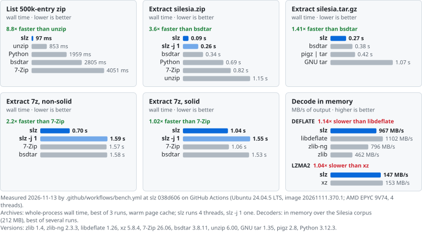
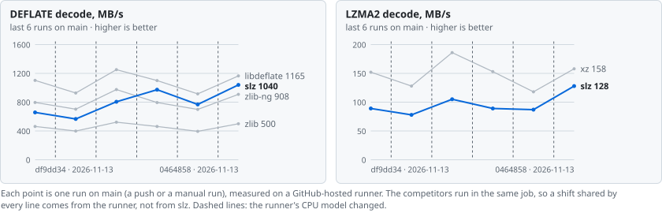

# Benchmarks

[slz](../README.md) > [docs](README.md) > Benchmarks

slz is measured in two ways: the [continuous benchmarks](#continuous-benchmarks) that CI runs on every push,
which draw the charts in the README, and the [detailed results](#detailed-results) measured on a 24-thread
desktop against the latest releases.

<picture>
  <source media="(prefers-color-scheme: dark)" srcset="https://raw.githubusercontent.com/seregonwar/slibz/bench-data/svg/hero-dark.svg">
  
</picture>

## Continuous benchmarks

Every push that changes code is benchmarked by [`.github/workflows/bench.yml`](../.github/workflows/bench.yml)
on a GitHub-hosted `ubuntu-24.04` runner, with slz and its competitors in the same job. zlib, zlib-ng,
libdeflate, xz (liblzma), libarchive (bsdtar) and pigz are built from pinned, checksummed sources, with
bsdtar and pigz linked to that zlib-ng (its zlib-compatible build) rather than to a distribution's zlib,
and 7-Zip (`7zz`) is its official build ([`.github/bench/deps.sh`](../.github/bench/deps.sh)); unzip, GNU tar
and Python are the runner's. The banner at the top is redrawn from the newest run on `main` and prints
its date, commit, CPU and versions; the chart below follows the decoders over the last runs on `main`.

<picture>
  <source media="(prefers-color-scheme: dark)" srcset="https://raw.githubusercontent.com/seregonwar/slibz/bench-data/svg/trend-dark.svg">
  
</picture>

- **What runs**: the in-memory decoders over the Silesia corpus (`tests/bench_inflate.c`,
  `tests/bench_lzma.c`), then whole-process listing and extraction of zip, tar.gz and 7z archives
  (`tests/bench.py`, best of 3 runs, warm page cache).
- **Noise**: a hosted runner is a shared virtual machine with a few threads, and the CPU model can
  change between runs, so absolute numbers move from run to run and are lower than on the machine of
  the [detailed results](#detailed-results). The speed of slz *relative* to a competitor measured in the
  same job is much steadier, and that is what is compared over time.
- **Regressions**: each run's job summary compares slz's speed relative to the format's standard tool
  (zlib, xz, unzip, GNU tar, 7-Zip) with the last run on `main`, on the same CPU model when there is
  one, and adds a warning when it drops by more than the noise: 3 robust standard deviations of the
  recent runs on that CPU, at least 5% (10% until there are five of them). A warning never fails the
  build: re-run the job to confirm it.
- **Data**: results, history and badges live on the
  [`bench-data`](https://github.com/seregonwar/slibz/tree/bench-data) branch
  ([dashboard](https://github.com/seregonwar/slibz/blob/bench-data/README.md),
  [`history.json`](https://github.com/seregonwar/slibz/blob/bench-data/history.json)), written only by
  runs on `main`, so `main`'s history has no bot commits. Runs on other branches and pull requests
  upload the same report and banners as an artifact.

To run the same benchmark on Linux (x86-64; needs a C compiler, CMake, curl, zip and unzip):

```bash
bash .github/bench/deps.sh tools deps && bash .github/bench/deps.sh corpus corpus
python3 .github/bench/run.py --deps deps --corpus corpus --work work --out out
python3 .github/bench/report.py publish out/result.json --site site --preview   # banners in site/svg
```

## Detailed results

Compared against the **latest releases** (November 2026), built from source where the distribution's
were older: 7-Zip 26.06 (`7zz`), libarchive 3.8.11 (bsdtar) on zlib-ng 2.3.3 and xz 5.8.4, pigz 2.8 on
zlib-ng, zlib 1.4, zlib-ng 2.3.3, libdeflate 1.26, xz 5.8.4. Info-ZIP unzip 6.0 is its latest release;
GNU tar 1.34 and Python 3.10 are the system versions.

Machine: 24 threads, Windows 11 + WSL2 Ubuntu 22.04, ext4 on a virtual disk, warm page cache, GCC 11
`-O2`. Corpora: [Silesia](https://sun.aei.polsl.pl/~sdeor/index.php?page=silesia) (12 files, 212 MB);
"small" = 17 414 files / 193 MB copied from `/usr/include`, `/usr/share/doc` and `/usr/lib/python3`;
a 500 000-entry zip. Archives were made with Info-ZIP `zip -6`, GNU tar + gzip, and 7-Zip 26.06 with
default settings. Times are for whole processes, best of 3. To reproduce, run `tests/bench.py`
(competitor binaries via `SZ_BIN`, `BSDTAR_BIN`, `PIGZ_BIN`, ...), `tests/bench_inflate.c` and
`tests/bench_lzma.c`.

### Decoders alone (in memory, Silesia, MB/s of output)

| codec | slz | reference |
|---|---|---|
| DEFLATE (zlib -6 streams) | **650-690** | zlib 1.4: 448, zlib-ng 2.3.3: 689, libdeflate 1.26: 1 252 |
| LZMA2 (xz preset 6 streams) | **91** | xz 5.8.4: 150 |

The slz decoders stream with bounded memory and can be resumed. libdeflate decodes whole buffers only.

### Listing (ms, whole process)

| archive | entries | slz | unzip -Z1 | bsdtar -t | 7z l | python zipfile |
|---|---|---|---|---|---|---|
| silesia.zip | 12 | 1 | 2 | 2 | 3 | 27 |
| small.zip | 17414 | 5 | 12 | 44 | 50 | 99 |
| 500k entries | 500000 | 81 | 228 | 1376 | 1694 | 2008 |

### Extraction, zip (s)

| archive | files / MB | slz (-j 24) | slz -j 1 | unzip | bsdtar | 7z x | python zipfile |
|---|---|---|---|---|---|---|---|
| silesia.zip | 12 / 212 | 0.14 | 0.41 | 1.07 | 0.41 | 0.82 | 0.87 |
| small.zip | 17414 / 193 | 0.61 | 0.97 | 1.48 | 0.89 | 1.28 | 1.70 |

### Extraction, tar.gz (s)

| archive | slz | GNU tar -xzf | pigz -d \| tar -x | bsdtar |
|---|---|---|---|---|
| silesia.tar.gz | 0.42 | 1.01 | 0.56 | 0.43 |
| small.tar.gz | 0.64 | 1.03 | 0.73 | 0.80 |

### 7z (s; listing in ms)

| archive | slz list | 7z l | slz x | slz x -j 1 | 7z x | bsdtar -x |
|---|---|---|---|---|---|---|
| silesia.7z | 1 | 2 | 2.58 | 2.52 | 1.08 | 1.72 |
| silesia-nonsolid.7z | 1 | 2 | 0.77 | 2.59 | 1.61 | 1.70 |
| small.7z | 17 | 45 | 2.04 | 2.07 | 1.22 | 1.57 |
| small-nonsolid.7z | 21 | 49 | 0.59 | 3.02 | 2.01 | 2.12 |

### Summary

- **Listing**: slz is the fastest in every case. It lists 500 000 entries 2.8 times faster than unzip
  and about 17-21 times faster than libarchive and 7-Zip.
- **zip**: slz is the fastest (2.9 times faster than bsdtar 3.8 on Silesia, 1.5 times on small files).
- **tar.gz**: tied with bsdtar on large files, fastest on many small files.
- **7z, non-solid** (one folder per file): extracted in parallel, 2.1-3.4 times faster than 7-Zip 26.06.
- **7z, solid**: **7-Zip 26.06 is 2.4 times faster.** It decodes the independent LZMA2 segments of a
  solid block in parallel, and its LZMA decoder is faster single-threaded too. slz decodes a solid
  block sequentially at ~61% of xz's single-thread speed. This is the main gap (see the [roadmap](roadmap.md)).
- **Large archive** (1.5 GB zip of low-redundancy data, 2 003 entries, 1.96 GB out): slz 1.58 s,
  bsdtar 6.15 s, unzip 8.02 s (system versions). In-place mode takes 18.4 s for the same archive,
  because every checkpoint makes the output durable (fsync) before freeing archive space. The peak
  footprint was +28.5 MB over max(archive, output) with a 32 MiB checkpoint interval.
